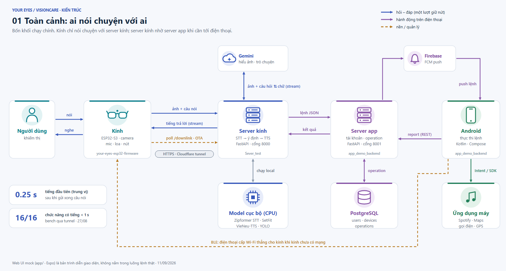
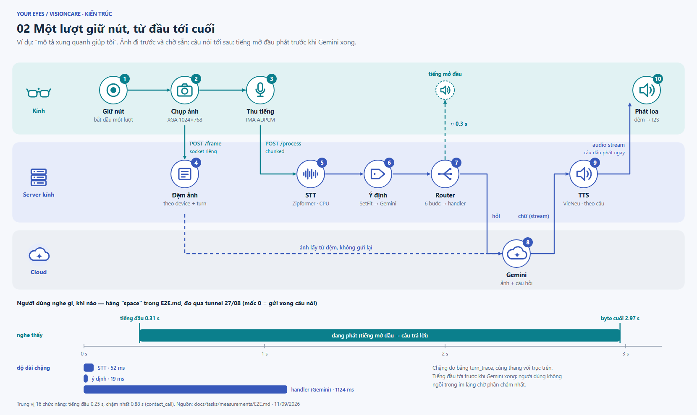
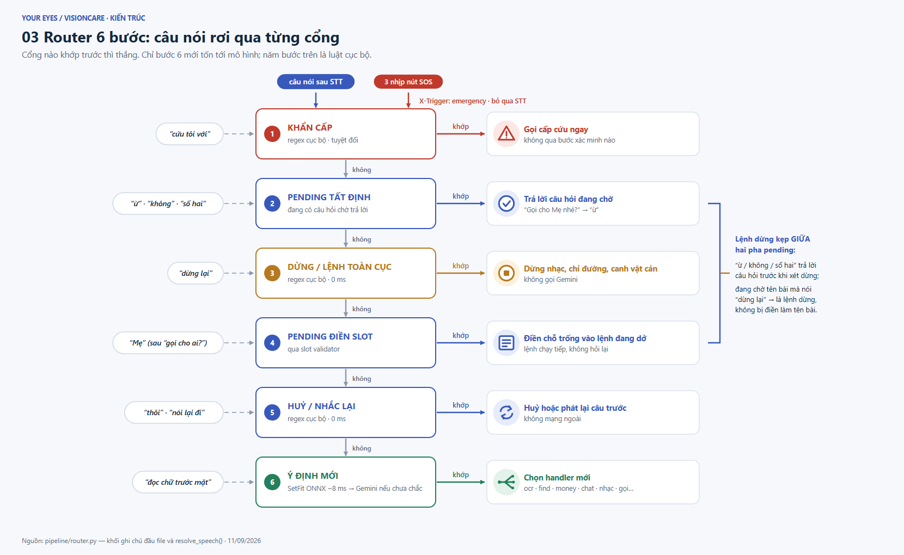
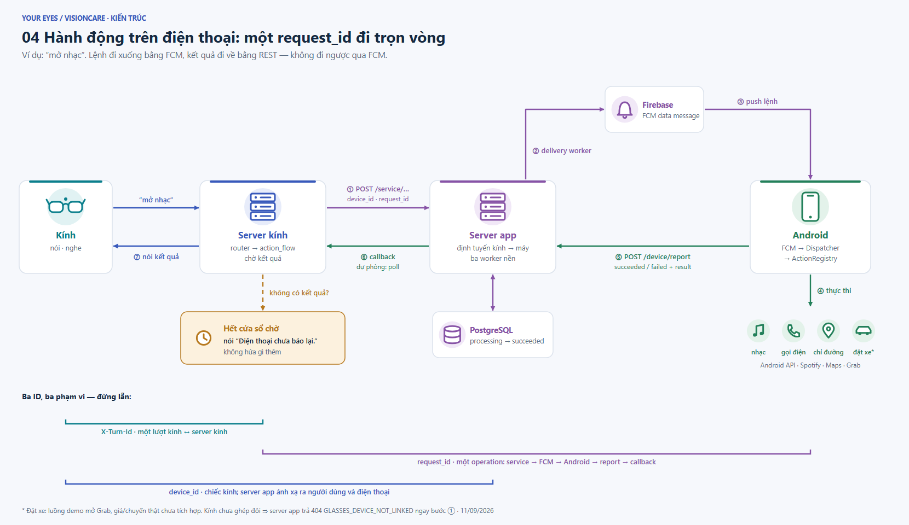
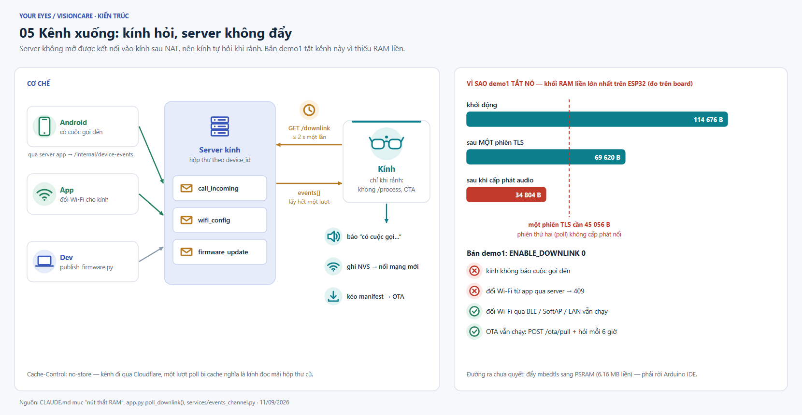
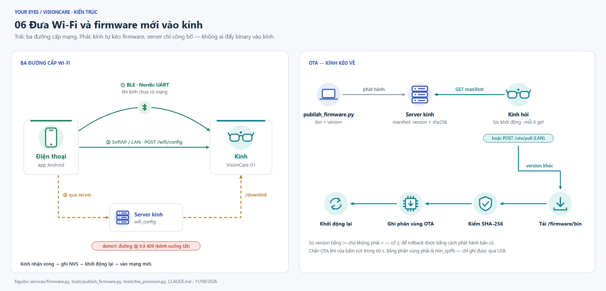
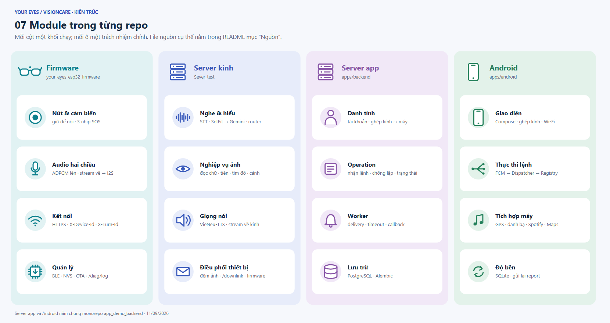

# Your Eyes / VisionCare — Kiến trúc bằng hình

> **Kính cảm nhận · Server hiểu · Điện thoại hành động.**
> Bảy hình, mỗi hình giải thích một cơ chế. Mở **[index.html](index.html)** để xem cỡ lớn (bấm vào hình để phóng to) hoặc in ra PDF.

| | | |
|---|---|---|
| [01 · Toàn cảnh](#01--toàn-cảnh) | [02 · Một lượt](#02--một-lượt-giữ-nút) | [03 · Router 6 bước](#03--router-6-bước) |
| [04 · Hành động trên điện thoại](#04--hành-động-trên-điện-thoại) | [05 · Kênh xuống](#05--kênh-xuống) | [06 · Wi-Fi & OTA](#06--wi-fi--ota) |
| [07 · Module](#07--module) | [Đã có gì](#đã-có-gì-còn-thiếu-gì) | [Chi tiết & nguồn](#chi-tiết) |

Đây là **kiến trúc mục tiêu**, dựa trên mã hiện có của ba repo. Hình vẽ cả những phần đang tích hợp dở. Trạng thái thật của từng phần nằm ở bảng [Đã có gì](#đã-có-gì-còn-thiếu-gì).

---

## 01 · Toàn cảnh



- **Kính chỉ nói chuyện với server kính.** Mọi thứ cần tới điện thoại đều đi vòng qua server app, không đi thẳng.
- **Màu mũi tên cho biết loại luồng:** xanh dương là hỏi – đáp, tím là hành động trên điện thoại, cam nét đứt là tác vụ nền.
- BLE là đường duy nhất nối điện thoại với kính mà không đi qua server. Nó chỉ dùng để cấp Wi-Fi khi kính chưa có mạng.

## 02 · Một lượt giữ nút



- **Ảnh đi trước và nằm chờ ở server.** `POST /frame` đi trên socket riêng, kính gửi xong là quên. Tới lúc Gemini cần thì server lấy ảnh ra từ bộ đệm, kính không phải gửi lại.
- **Tiếng mở đầu phát trước khi có câu trả lời.** Số đo thật: người dùng nghe tiếng đầu ở giây 0.31, trong khi riêng Gemini đã mất 1.12 s.
- TTS đọc theo từng câu. Câu đầu được phát trong lúc Gemini còn đang viết các câu sau.

## 03 · Router 6 bước



- Câu nói đi qua từng cổng theo thứ tự, **cổng nào khớp trước thì thắng**. Chỉ khi rơi tới bước 6 mới phải gọi mô hình.
- **Khẩn cấp là tuyệt đối.** Bấm 3 nhịp nút sẽ bỏ qua cả STT.
- Lệnh dừng được đặt **giữa** hai pha pending. Nhờ vậy câu "ừ" vẫn trả lời được câu hỏi đang chờ, còn câu "dừng lại" không bị nhầm thành một giá trị cần điền.

## 04 · Hành động trên điện thoại



- **Lệnh đi xuống qua FCM, kết quả đi về qua REST.** Không có chiều nào đi ngược qua FCM.
- Nếu hết cửa sổ chờ mà vẫn chưa có kết quả, kính nói *"Điện thoại chưa báo lại."* và không hứa gì thêm.
- **Ba ID có phạm vi khác nhau:** `X-Turn-Id` gắn với một lượt nói, `request_id` gắn với một operation, `device_id` gắn với một chiếc kính.

## 05 · Kênh xuống



- Kính nằm sau NAT nên server không mở kết nối vào kính được. **Kính tự hỏi `GET /downlink`**, khoảng 2 giây một lần và chỉ khi đang rảnh.
- **Bản demo1 tắt kênh này (`ENABLE_DOWNLINK 0`).** Sau khi cấp phát audio, khối RAM liền trên board chỉ còn 34 804 B, trong khi một phiên TLS cần 45 056 B.

## 06 · Wi-Fi & OTA



- Có **ba đường cấp Wi-Fi.** BLE dùng khi kính chưa có mạng. SoftAP/LAN dùng khi điện thoại và kính cùng mạng. Đường thứ ba đi qua server, và bị tắt trong demo1.
- **OTA do kính kéo về:** server chỉ công bố manifest, kính tự tải binary, kiểm SHA-256, ghi vào phân vùng OTA rồi khởi động lại.

## 07 · Module



---

## Đã có gì, còn thiếu gì

| Hạng mục | Mức độ |
|---|---|
| Thu ảnh/tiếng → AI → TTS; backend → FCM → Android → report/callback | **Đã có mã** cho các thành phần chính; cần cấu hình và kiểm thử trên từng điện thoại cụ thể |
| HTTPS / Cloudflare | **Có cấu hình và tài liệu**; cần chuẩn hoá đường kết nối khi tích hợp |
| Ảnh riêng qua `/frame`, định danh thiết bị/lượt | **Server đã có**; cần đồng bộ với firmware |
| Downlink, cuộc gọi đến, Wi-Fi/OTA qua server | **Server/app có mã và hợp đồng**; demo1 tắt downlink vì RAM (hình 05) |
| Canh vật cản liên tục | **Server có depth/YOLO/risk engine**; vòng chụp + âm báo trên kính chưa kiểm chứng trên phần cứng |
| Đặt xe | **Luồng demo** mở Grab; giá/chuyến thật cần nhà cung cấp |
| `navigation_stop` | Android không dùng Navigation SDK. Report "stopped" **không** chứng minh Google Maps đã dừng dẫn đường |
| `app_demo_backend/app` | UI mock bằng Expo, **tách khỏi** luồng lệnh thật |

"Đã có mã" nghĩa là khảo sát source thấy có, **không phải** đã nghiệm thu end-to-end trên kính và điện thoại thật.

Thứ tự hoàn thiện đề xuất: **(1)** thống nhất ID và giao thức firmware/server → **(2)** nối ổn định action/report/callback → **(3)** downlink và thông báo chủ động → **(4)** cấp mạng/OTA → **(5)** canh vật cản và tích hợp nhà cung cấp.

---

## Chi tiết

<details>
<summary><b>Công nghệ từng khối</b></summary>

| Khối | Công nghệ |
|---|---|
| Kính — `your-eyes-esp32-firmware` | ESP32-S3 N16R8, OV2640, INMP441, MAX98357A; Arduino + API ESP-IDF, FreeRTOS, I2S, PSRAM, BLE, NVS, OTA |
| Server kính — `Sever_test` | Python, FastAPI/Uvicorn; Zipformer-vi 30M int8 (sherpa-onnx); SetFit ONNX int8; Google GenAI SDK/Gemini; VieNeu-TTS v3 Turbo (CPU); httpx |
| Server app — `app_demo_backend/apps/backend` | Python 3.13, FastAPI, Pydantic, SQLAlchemy async, asyncpg, PostgreSQL, Alembic, Firebase Admin SDK; ba worker nền (delivery, timeout, callback) |
| Android — `app_demo_backend/apps/android` | Kotlin, Jetpack Compose/Material 3, Coroutines, Firebase Messaging, SQLite, API location/telephony/media, Spotify App Remote |
| Web UI mock — `app_demo_backend/app` | TypeScript, Expo 56, React 19, React Native 0.85 — không tham gia thực thi lệnh |

Hai server có thể chạy chung trên một laptop (cổng `8000` và `8001`). Đó là hai tiến trình khác vai trò, không bắt buộc chạy trên hai máy.
</details>

<details>
<summary><b>Dữ liệu được giữ ở đâu</b></summary>

| Nơi lưu | Nội dung |
|---|---|
| RAM/PSRAM + NVS trên kính | ảnh/audio đang xử lý; số máy, cấu hình Wi-Fi |
| RAM server kính | hội thoại, pending, đệm ảnh, hộp thư downlink, kết quả chống lặp theo lượt — **mất khi khởi động lại** |
| `models/` `storage/` `logs/` `firmware/` | model cục bộ; ảnh/audio debug; log; bản firmware phát hành |
| PostgreSQL (server app) | users, sessions, devices, liên kết kính, operations, preferences, tickets |
| SQLite + SharedPreferences (Android) | commands, report chờ gửi lại; cấu hình app |
| Cloud | Gemini nhận nội dung theo handler; FCM chuyển JSON lệnh |
</details>

<details>
<summary><b>File nguồn đối chiếu</b></summary>

Đường dẫn tính từ `docs/architecture/`.

| Chủ đề | File |
|---|---|
| Firmware | [README](../../../your-eyes-esp32-firmware/README.md), [board_config.h](../../../your-eyes-esp32-firmware/board_config.h), [app_config.h](../../../your-eyes-esp32-firmware/app_config.h), [api_client.cpp](../../../your-eyes-esp32-firmware/src/net/api_client.cpp) |
| API server kính | [app.py](../../app.py) (`/frame`, `/process`, `/downlink`, `/firmware/*`), [router.py](../../pipeline/router.py), [config.py](../../config.py) |
| AI & audio | [stt.py](../../pipeline/stt.py), [intent.py](../../pipeline/intent.py), [tts.py](../../pipeline/tts.py) |
| Nối sang app | [visioncare_client.py](../../services/visioncare_client.py), [action_flow.py](../../handlers/action_flow.py), [events_channel.py](../../services/events_channel.py), [firmware.py](../../services/firmware.py) |
| Backend | [application.py](../../../app_demo_backend/apps/backend/src/app/application.py), [workers/runner.py](../../../app_demo_backend/apps/backend/src/app/workers/runner.py), [adapters/delivery.py](../../../app_demo_backend/apps/backend/src/app/adapters/delivery.py), [api/device.py](../../../app_demo_backend/apps/backend/src/app/api/device.py) |
| Android | [FcmPushReceiver.kt](../../../app_demo_backend/apps/android/app/src/main/java/com/youreyes/app/fcm/FcmPushReceiver.kt), [CommandDispatcher.kt](../../../app_demo_backend/apps/android/app/src/main/java/com/youreyes/app/dispatcher/CommandDispatcher.kt), [ActionRegistry.kt](../../../app_demo_backend/apps/android/app/src/main/java/com/youreyes/app/actions/ActionRegistry.kt) |
| Số đo | [E2E.md](../tasks/measurements/E2E.md) (hình 01, 02), [CLAUDE.md](../../CLAUDE.md) mục "nút thắt RAM" (hình 05) |

Mốc Git lúc khảo sát: firmware `2c16f44`, server kính `6f94ebe`, app monorepo `c758898`.
</details>

<details>
<summary><b>Thuật ngữ</b></summary>

**STT**: chuyển tiếng nói thành chữ · **TTS**: chuyển chữ thành tiếng nói · **intent**: loại yêu cầu · **handler**: bộ xử lý một chức năng · **pending**: câu hỏi đang chờ người dùng trả lời · **slot**: chỗ trống cần điền (tên người, tên bài) · **FCM**: dịch vụ push của Firebase · **callback**: server gọi ngược lại để báo kết quả · **poll**: hỏi lại theo chu kỳ · **OTA**: cập nhật firmware qua mạng · **NVS**: vùng nhớ cấu hình bền của ESP32 · **operation**: một yêu cầu hành động được theo dõi tới khi có kết quả.
</details>

---

## Sửa hình

Mọi hình đều được sinh ra từ mã, **đừng sửa file SVG/PNG bằng tay.**

```bash
python docs/architecture/build_diagrams.py   # 7 SVG + index.html (chỉ stdlib)
python docs/architecture/render.py           # PNG + PDF qua Chrome/Edge headless, kiểm chữ đè nhau
```

`render.py` trả exit 1 nếu có nhãn đè lên nhau hoặc nằm ngoài khung.
