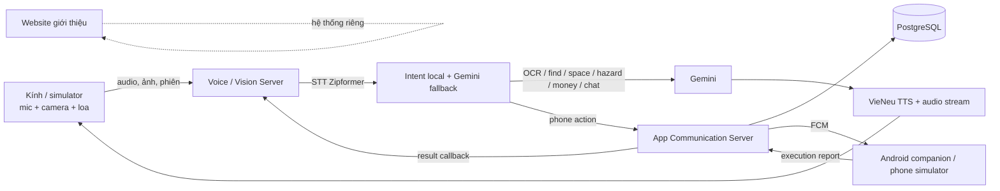

# SeeVia — tổng quan dự án và hướng dẫn đọc tài liệu

**Cập nhật:** 20/10/2026 (Asia/Ho_Chi_Minh)  
**Phạm vi:** workspace `SeeVia_system`, gồm voice/vision server, App Communication Server, Android companion hiện có, website giới thiệu, thử nghiệm và tài liệu liên quan.

> Đây là bản tổng hợp từ source, tài liệu và báo cáo đang có. Báo cáo đo lường được ghi theo đúng phạm vi; test E2E mô phỏng không được xem là kiểm chứng trên kính hay điện thoại thật. Một số README/spec cũ mô tả mục tiêu hoặc thiết kế lịch sử, không nhất thiết là hành vi source hiện tại.

## 1. Tóm tắt điều hành

SeeVia là dự án kính hỗ trợ người khiếm thị và người suy giảm thị lực. Kính thu tiếng nói và ảnh; voice server nhận dạng yêu cầu, hiểu ảnh/hội thoại hoặc điều phối hành động trên điện thoại; App Communication Server chuyển lệnh tới app Android và nhận kết quả; phản hồi được đọc lại bằng giọng nói.

Workspace hiện có một prototype phần mềm nhiều thành phần:

- **Voice/vision server** xử lý tiếng Việt, phân loại lệnh, xử lý ảnh bằng Gemini, hội thoại, tổng hợp tiếng nói và stream audio. Có giao thức phiên WebSocket v2 và các API HTTP dự phòng.
- **App Communication Server** có API, PostgreSQL, operation queue bền vững, gửi FCM, nhận kết quả từ điện thoại, timeout, retry và callback.
- **Android companion hiện tại** có UI và thực thi một số tác vụ trên điện thoại. Tên/package trong source hiện là Your Eyes (`com.youreyes.app`); thiết kế app SeeVia mới đã được soạn riêng nhưng chưa được duyệt/build.
- **Luồng gọi/nhắn qua Internet và khẩn cấp** đã được nối giữa kính giả lập, voice server, backend và simulator. E2E mới nhất báo 11/11 kịch bản đạt trong stack local giả lập.
- **Website giới thiệu** là ứng dụng riêng, song ngữ Việt–Anh; có nội dung dự án, liên hệ, chatbot Cohere và backend gửi email tùy cấu hình.
- **Firmware kính không nằm trong workspace.** Không có source firmware, cấu hình build/flash hay thiết bị thật kèm theo đây.

Hai repository con là `visioncare-host-demo` và `app-demo-backend`; cả hai đang ở nhánh `voice-v2-hardening`, sạch tại lần kiểm tra này. Commit gần nhất voice server `d8716a1` (20/10/2026 15:51 +07); app/backend `36df0d4` (20/10/2026 15:14 +07). Ghi chú bàn giao nói các nhánh chưa push. Thư mục gốc không có Git metadata hoạt động nên lịch sử commit được đối chiếu từ hai repository con.

## 2. Kiến trúc tổng thể

| Thành phần | Trách nhiệm | Trạng thái hiện tại |
|---|---|---|
| Kính | Thu audio/ảnh, phát audio, điều khiển phiên/live | Giao thức và simulator có; firmware không nằm trong workspace |
| Voice server (`visioncare-host-demo/`) | STT, intent/slot, ảnh, hội thoại, TTS, WebSocket, điều phối action | Có source/E2E mô phỏng; phụ thuộc model, key và cấu hình triển khai |
| App Communication Server (`app-demo-backend/server/`) | Auth, ghép kính, lưu operation, FCM, report, timeout/callback | Có source và suite test; triển khai cần secrets/PostgreSQL/FCM |
| Android (`app-demo-backend/mobile/`) | Nhận command, thực thi bằng capability/provider Android, báo kết quả | App Your Eyes hiện có; tính năng có thể thật, mở app ngoài hoặc mô phỏng |
| Website (`ui/web/`) | Giới thiệu dự án, nội dung, liên hệ, chatbot | Ứng dụng React riêng, không phải UI điều khiển kính |
| Experiments (`experiments/`, `stt-bench-cache/`) | Benchmark giả lập/STT và tổng hợp số liệu | Có kết quả; mỗi phép đo có scope riêng |

### Hai luồng chính

**Hỏi đáp/nhìn ảnh:** kính gửi lượt → voice server nhận audio → Zipformer chuyển tiếng nói thành chữ → intent local hoặc Gemini chọn yêu cầu → handler gọi Gemini nếu cần hiểu ảnh/chat → TTS tạo câu trả lời → server stream audio về kính. OCR/nav có thể tiếp tục trao đổi ảnh và thông báo live qua WebSocket.

**Hành động qua điện thoại:** voice server hiểu lệnh và đọc lại yêu cầu → sau cửa sổ hủy gửi request đến backend → backend xác thực kính, xác định chủ và điện thoại → ghi operation vào PostgreSQL, trả `202 Accepted` → worker gửi FCM → app thực thi và báo cáo → backend lưu kết quả, trả qua status/callback → voice server đọc kết quả nếu phiên còn phù hợp.

## 3. Voice/vision server

### 3.1 Pipeline và khả năng

- **STT:** Vietnamese Zipformer 30M RNN-T int8 qua `sherpa-onnx`; hỗ trợ WAV PCM và IMA ADPCM theo định dạng thiết bị.
- **Intent và slots:** SetFit-derived ONNX classifier chạy local; Gemini structured JSON làm fallback khi phân loại/slot không đủ chắc. Nhóm lệnh gồm vision, chat, navigation, call, ride, music.
- **Ảnh:** Gemini cho OCR/đọc chữ, tìm vật, mô tả không gian, cảnh báo nguy hiểm và nhận diện tiền. Bộ lọc có kiểm tra thiếu ảnh/độ sáng và một số điều kiện nét; money hiện dựa vào prompt Gemini, không có bước xác minh mệnh giá xác định như một số tài liệu thiết kế cũ mô tả.
- **Chat:** Gemini, có thể kèm Google Search; có cache vị trí lấy từ điện thoại và lịch sử hội thoại trong tiến trình.
- **TTS/truyền audio:** VieNeu-TTS, stream theo câu; định dạng IMA ADPCM WAV/raw ADPCM, MP3, PCM stream và WAV.
- **Live:** giao thức WS `/v2/session` hỗ trợ phiên nói, ảnh/live OCR và cảnh báo hazard/navigation theo firmware protocol. HTTP v2 và `POST /process` còn là đường dự phòng/legacy.
- **Action:** nhạc, volume, navigation, ride, gọi liên hệ, khẩn cấp và các action/backend mới cho call/message.

Điểm vào, endpoint và khung giao thức xem [README voice server](../visioncare-host-demo/README.md), [FIRMWARE_ENDPOINTS](../visioncare-host-demo/docs/FIRMWARE_ENDPOINTS.md), [hướng dẫn server](../visioncare-host-demo/docs/HUONG_DAN_SERVER.md) và [kiến trúc server](../visioncare-host-demo/docs/KIEN_TRUC_SERVER.md).

### 3.2 STT mới nhất

Ngày 20/10, Zipformer được giữ nguyên nhưng cấu hình giải mã chuyển sang `modified_beam_search` kèm hotword. Hotword có nhóm từ lệnh cố định; code cũng có `stt.set_user_hotwords(...)` để ưu tiên tên người thân theo lượt. Có thể quay về greedy bằng `STT_DECODING=greedy_search`.

Bàn đo câu lệnh (`stt-bench-cache/report2.md`) gồm 2.400 clip dev/test và điều kiện clean/SNR 10. Một cấu hình kết hợp hotword đạt **88.0%** đúng từ khóa trên test sạch và **88.0%** trên test SNR 10, so với baseline greedy 84.2% và 81.1%. Intent cuối thay đổi ít hơn; WER trên 168 clip VietMed là 14.36% với một số cấu hình hotword so với 14.73% baseline. Độ trễ giải mã lượt cuối tăng khoảng 22–27 ms p90 theo ghi chú cập nhật. Đây là benchmark trên corpus/fixture cụ thể, không phải phép đo live trên kính.

**Chưa nối:** alias `care_links` từ backend vào `set_user_hotwords` theo `glasses_device_id`. Mức cải thiện nhận diện tên cá nhân hóa chưa được bảo đảm trong pipeline đang chạy.

### 3.3 WebSocket và hành vi mới

- Lệnh có tác dụng phụ được đọc lại trước khi thực thi. Trong cửa sổ hủy, nhấn nút, cancel hoặc rớt socket chặn command trước khi tới điện thoại.
- Kết quả action nền được gửi lại qua phiên WS dưới dạng `result-<request_id>` để kính phát sau câu hiện tại. Đường HTTP cũ không có kênh audio kết quả nền.
- Khi nhạc/navigation chạy, lượt có lời được phân loại bình thường; nhấn nút không lời mới dùng để dừng. Dừng navigation đóng live nav.
- Tin nhắn tới khi kính bận được xếp hàng sau câu hiện tại, không chèn audio giữa chừng.

Đây là thay đổi so với bản tổng quan ngày 18/10, vốn nói mọi request lúc đang phát nhạc/dẫn đường đều thành lệnh stop. Báo cáo E2E và source 20/10 mô tả hành vi đã sửa; ưu tiên source/handoff mới hơn khi có mâu thuẫn.

### 3.4 Giới hạn voice

- Hội thoại, vị trí, nhạc/nav, callback waiter và một số pending action còn dùng state toàn tiến trình; chưa cô lập đầy đủ theo user/device và mất khi restart.
- Một số luồng cần Gemini/API/model assets; source không chứa đủ model weights và không xác minh provider trong môi trường triển khai.
- Gọi/nhắn audio hai chiều được kiểm bằng simulator/loopback; chưa kiểm mạng Internet thực, echo cancellation trên phần cứng hay trải nghiệm Android thật.
- Còn hồi quy STT/intent với một vài câu trong ghi chú bàn giao; scenario `sc_alert` với ảnh hazard mức 2 mới chưa chạy lại theo NEXT_SESSION.

## 4. App Communication Server và API

Backend dùng FastAPI, Python 3.13, SQLAlchemy async, PostgreSQL/Alembic và Firebase Admin. PostgreSQL lưu operation queue; không có Celery/Redis làm hàng đợi action. Worker chạy cùng ứng dụng backend.

Public service API có **13 action chuẩn**: báo giá/xác nhận xe, play/stop/volume nhạc, bắt đầu/dừng navigation, emergency call, contact call, lấy vị trí, đọc capabilities, answer/reject cuộc gọi. Status, auth/account, pairing, preferences, support, device report/event và health nằm ngoài nhóm 13 action. Xem [external-client-api.md](../app-demo-backend/docs/external-client-api.md) và [project-context.md](../app-demo-backend/docs/project-context.md).

Đảm bảo chính:

1. Client gửi `device_id` kính, `request_id` UUID và bearer token.
2. Backend xác định chủ kính/điện thoại; request mới được lưu bền vững trước khi trả 202.
3. Retry cùng request ID/payload là idempotent; cùng ID nhưng nội dung khác bị conflict.
4. Worker gửi FCM, Android report kết quả, timeout worker xử lý quá hạn, callback worker công bố terminal result.
5. `202 Accepted` nghĩa là backend nhận/lưu lệnh; không khẳng định FCM đã giao hay điện thoại thực thi.

Ngày 20/10 backend được cập nhật để suy chủ từ `glasses_device_id` cho calls/messages/emergency, cô lập hai kính và trả `call_id` trong một số phản hồi emergency/stop khi người nghe đã nhận cuộc gọi. `relative_sim` mô phỏng người thân đăng ký tài khoản, OTP, care links và nhận call/message; hợp đồng app-server ở [MOBILE_APP_PROTOCOL.md](../app-demo-backend/docs/MOBILE_APP_PROTOCOL.md).

## 5. Android companion: hiện trạng và app SeeVia dự kiến

### App trong source hiện có

Android app trong `app-demo-backend/mobile/` dùng Kotlin, Jetpack Compose, Firebase Messaging, SQLiteOpenHelper và foreground service. App nhận command, dispatch action, lưu một phần trạng thái/report và gọi backend. Khả năng gồm nhạc/âm lượng, contact call, emergency, navigation, ride, location, capabilities, incoming call, pairing và cấp Wi-Fi cho kính. Một số tính năng mở app ngoài hoặc mô phỏng; ví dụ Grab quote là estimate cố định, Maps stop chủ yếu là trạng thái logic, một số màn hình dịch/họp là demo.

Chi tiết trong [mobile/README.md](../app-demo-backend/mobile/README.md) và [architecture.md](../app-demo-backend/docs/architecture.md). `MOBILE_APP_PROTOCOL.md` mô tả giao thức app-server; cần đọc chú thích về contract mới so với implementation hiện tại.

### App SeeVia theo spec mới

Spec ngày 20/10 đề xuất đổi trải nghiệm Your Eyes thành SeeVia và cung cấp gọi thoại Internet, tin nhắn, danh bạ và debug cho người dùng app. Các yêu cầu đã chốt: một loại tài khoản, danh bạ theo số, gọi kính↔điện thoại và điện thoại↔điện thoại, không video/không SIM cho cuộc gọi thường; khẩn cấp vẫn có SIM dự phòng; giữ package `com.youreyes.app`; ẩn màn hình không có backend.

**Chưa thực hiện:** spec chưa qua builder check/người dùng duyệt chính thức; chưa có app SeeVia mới hoặc APK được xác nhận build. Không nhầm E2E call/message của voice/backend simulator với app Android mới đã hoàn thiện. Xem [spec thiết kế app](../app-demo-backend/docs/superpowers/specs/2026-10-20-seevia-mobile-app-design.md) và [bàn giao app](../app-demo-backend/docs/superpowers/NEXT_SESSION_APP.md).

## 6. Website và nội dung truyền thông

`ui/web/` là ứng dụng React 19 + TypeScript + Vite riêng, song ngữ Việt–Anh. Có trang chủ, tổng quan, sản phẩm, công nghệ, cộng đồng, tin tức, đối tác, về chúng tôi, liên hệ và chính sách. Nội dung mô phỏng AI ở website là kịch bản viết sẵn; nút **Hỏi SeeVia AI** là chatbot văn bản dựa trên Cohere và nội dung dự án đã duyệt, không bật camera. Liên hệ có thể lưu/tải draft và gửi email qua Mailgun khi backend/cấu hình được bật.

Xem [README website](../ui/web/README.md), [backend contact/chatbot](../ui/web/contact-backend/README.md), [lịch sử chatbot](../ui/web/CHAT_HISTORY.md) và README từng trang trong danh mục cuối. Website không có nghĩa kính đã có phần cứng hay AI thị giác chạy thật.

Workspace còn có slide, tài liệu vòng 2 AISC và bản GitHub Pages trong `ui/slide_vong2/`; đây là tư liệu thuyết trình, không phải source runtime của kính.

## 7. Kiểm thử và benchmark

### E2E 20/10

`visioncare-host-demo/docs/E2E_FULL_FLOW.md` ghi stack local gồm kính giả lập, voice server, App Communication Server, `phone_sim` và `relative_sim`. Báo cáo 11/11 kịch bản call/message/emergency PASS: chọn người thân khi tên trùng, hủy, tin tới khi kính bận/rảnh, emergency gọi nhiều người theo thứ tự và dừng emergency. Âm thanh cuộc gọi dùng tiếng “tách” mô phỏng; timing là loopback, mẫu nhỏ. Đây không phải kiểm chứng mạng Cloudflare hay máy thật.

Cùng file có nhóm luồng trước đó cho call thường, ride, music, nav và emergency. Thời gian nhả nút tới command gồm thời gian đọc lại/cửa sổ hủy; không thể hiểu là độ trễ FCM/mạng.

### Benchmark giả lập ngày 18/10

`experiments/2026-10-18/` ghi 22.838 dòng: HTTP streaming/codec với AI giả lập, backend/PostgreSQL với delivery/report giả lập, microbenchmark codec và quality gate ảnh tổng hợp, cùng kết quả suite đã ghi lại. Chưa đo WER/accuracy model thật, Gemini TTFT, TTS thật, nghe thật, phần cứng hay Android completion. Latency giả lập không chứng minh mục tiêu end-to-end dưới 1 giây.

### Số test được ghi nhận

- NEXT_SESSION voice (20/10): 515 passed, 2 skipped; backend 420 passed với PostgreSQL test; `tools/e2e_calls.py` 11/11 local.
- Snapshot test cũ trong báo cáo 18/10: voice 374 passed, 2 failed, 15 skipped; backend 370 passed, 1 failed. Không gộp các số khác scope/thời điểm.
- Website có test scripts và ghi chú known failures; chưa chạy lại trong lúc tạo tài liệu này.
- **Không chạy test trong lần tổng hợp này.** Số liệu lấy từ artifact/docs hiện có.

## 8. Việc còn lại và giới hạn ưu tiên

1. Nối alias hotword cá nhân hóa từ `care_links` theo kính; cache và cập nhật khi danh bạ đổi.
2. Rà soát STT/intent với câu hazard và “Mẹ vừa nhắn gì”; chạy lại `sc_alert` với ảnh mới.
3. Chốt app Android SeeVia: builder check/duyệt spec, thực hiện app, build APK debug, kiểm thử trên điện thoại thật.
4. Xác minh qua hạ tầng thật: Cloudflare, FCM, Android; đo audio hai chiều, ringing khi app nền/máy khóa, echo/AEC và hoàn tất action.
5. Ghi chú bàn giao báo `.env` gốc có biến lặp với giá trị khác (`FIELD_ENCRYPTION_KEY`, token hashes). Chủ dự án cần xác định giá trị đúng; không tự xóa/đổi khóa mã hóa.
6. Đóng khoảng trống sản phẩm: state voice theo thiết bị, hội thoại bền vững, xác minh tiền, recovery/report Android độc lập, làm rõ hành vi thực của ride/navigation/emergency.
7. Cập nhật tài liệu cũ. Summary ngày 18/10 và một số README/contract có nội dung lịch sử; đối chiếu source/handoff ngày 20/10.

## 9. Mốc cập nhật và bằng chứng

| Mốc | Bằng chứng |
|---|---|
| 20/10: STT beam + hotword lệnh/tên | Voice commit `cf42a0d`; `visioncare-host-demo/config.py`; `stt-bench-cache/report2.md` |
| 20/10: E2E call/message/emergency và contract app | `visioncare-host-demo/docs/E2E_FULL_FLOW.md`; backend commit `67cb2a4`; spec app trong `app-demo-backend/docs/superpowers/` |
| 20/10: review cuối và việc còn lại | `visioncare-host-demo/docs/superpowers/NEXT_SESSION.md`; backend `NEXT_SESSION_APP.md` |
| 18/10: benchmark giả lập/codec/backend | `docs/seevia_metrics_analysis_summary.md`, `docs/METRICS_VA_THU_NGHIEM_GIA_LAP.md`, `experiments/2026-10-18/` |

## 10. Thứ tự đọc gợi ý

1. Tài liệu này.
2. [Tóm tắt source dự án (18/10)](../summarize_seevia_project.md) — chi tiết backend/voice/Android; xem là snapshot cũ hơn các cập nhật ở đây.
3. [Kiến trúc voice v2](../visioncare-host-demo/docs/KIEN_TRUC_SERVER.md) → [firmware endpoints](../visioncare-host-demo/docs/FIRMWARE_ENDPOINTS.md) → [E2E full flow](../visioncare-host-demo/docs/E2E_FULL_FLOW.md) → [NEXT_SESSION voice](../visioncare-host-demo/docs/superpowers/NEXT_SESSION.md).
4. [Backend architecture](../app-demo-backend/docs/architecture.md) → [project context/API contract](../app-demo-backend/docs/project-context.md) → [external API](../app-demo-backend/docs/external-client-api.md) → [mobile protocol](../app-demo-backend/docs/MOBILE_APP_PROTOCOL.md).
5. [NEXT_SESSION app](../app-demo-backend/docs/superpowers/NEXT_SESSION_APP.md) → [spec SeeVia app](../app-demo-backend/docs/superpowers/specs/2026-10-20-seevia-mobile-app-design.md).
6. [Metric summary](seevia_metrics_analysis_summary.md) → [quy trình metric](METRICS_VA_THU_NGHIEM_GIA_LAP.md) → [STT report2](../stt-bench-cache/report2.md).
7. [README website](../ui/web/README.md) → backend website/contact và README các trang.
8. Dùng danh mục đầy đủ bên dưới cho các spec/plan lịch sử, tài liệu vận hành và trang web.

## 11. Danh mục toàn bộ Markdown trong workspace

Danh sách sau gồm **78 file `*.md` khác** được liệt kê trước khi tạo tài liệu này bởi `rg --files` (tôn trọng ignore rules, nên bỏ qua virtualenv/cache/build artifacts). Cộng tài liệu tổng hợp này là 79 file hiển thị theo cùng cách liệt kê. Đường dẫn tương đối từ `docs/`. Một số file là quy tắc làm việc, kế hoạch/spec lịch sử hoặc README cục bộ; không phải tất cả mô tả trạng thái runtime hiện tại.

### 11.1 Tổng quan và số liệu

- [Tóm tắt source SeeVia (18/10)](../summarize_seevia_project.md)
- [Tổng kết phân tích metric (18/10)](seevia_metrics_analysis_summary.md)
- [Metric và quy trình thử nghiệm giả lập](METRICS_VA_THU_NGHIEM_GIA_LAP.md)
- [STT benchmark report 1](../stt-bench-cache/report1.md) — baseline/beam/hotword vòng đầu.
- [STT benchmark report 2](../stt-bench-cache/report2.md) — so sánh mới hơn.

### 11.2 Backend, API và Android

- [Repository instructions (AGENTS)](../app-demo-backend/AGENTS.md)
- [README app/backend](../app-demo-backend/README.md)
- [Development/test rules](../app-demo-backend/claude.md)
- [Contracts README](../app-demo-backend/contracts/README.md)
- [Contract matrix](../app-demo-backend/contracts/contract-matrix.md)
- [Mobile app protocol](../app-demo-backend/docs/MOBILE_APP_PROTOCOL.md)
- [Backend architecture](../app-demo-backend/docs/architecture.md)
- [External client API](../app-demo-backend/docs/external-client-api.md)
- [Project context and business contract](../app-demo-backend/docs/project-context.md)
- [NEXT_SESSION_APP handoff](../app-demo-backend/docs/superpowers/NEXT_SESSION_APP.md)
- [SeeVia mobile app design spec](../app-demo-backend/docs/superpowers/specs/2026-10-20-seevia-mobile-app-design.md)
- [Backend troubleshooting](../app-demo-backend/docs/troubleshooting.md)
- [Android mobile README](../app-demo-backend/mobile/README.md)
- [Backend server README](../app-demo-backend/server/README.md)
- [Test fixture payload README](../app-demo-backend/server/tests/fixtures/server_payloads/README.md)

### 11.3 Voice/vision, giao thức, E2E và benchmark

- [Voice server README](../visioncare-host-demo/README.md)
- [Demo web README](../visioncare-host-demo/demo-web/README.md)
- [OCR architecture](../visioncare-host-demo/docs/ARCHITECTURE_OCR.md)
- [Full-flow E2E report](../visioncare-host-demo/docs/E2E_FULL_FLOW.md)
- [Real phone E2E guide](../visioncare-host-demo/docs/E2E_REAL_PHONE.md)
- [External validation datasets](../visioncare-host-demo/docs/EXTERNAL_VALIDATION_DATASETS.md)
- [Firmware endpoints/protocol](../visioncare-host-demo/docs/FIRMWARE_ENDPOINTS.md)
- [Voice v2 handoff](../visioncare-host-demo/docs/HANDOFF_VOICE_V2.md)
- [Hướng dẫn server](../visioncare-host-demo/docs/HUONG_DAN_SERVER.md)
- [Kiến trúc server](../visioncare-host-demo/docs/KIEN_TRUC_SERVER.md)
- [LLM provider setup](../visioncare-host-demo/docs/LLM_PROVIDER.md)
- [Detailed stage latency benchmark](../visioncare-host-demo/docs/benchmarks/DETAILED_STAGE_LATENCY_BENCHMARK.md)
- [Intent gold benchmark](../visioncare-host-demo/docs/benchmarks/INTENT_GOLD.md)
- [Load v2 benchmark](../visioncare-host-demo/docs/benchmarks/LOAD_V2.md)
- [Test results](../visioncare-host-demo/docs/benchmarks/TEST_RESULTS.md)
- [Voice latency benchmark](../visioncare-host-demo/docs/benchmarks/VOICE_LATENCY_BENCHMARK.md)
- [Endpoint reference](../visioncare-host-demo/docs/endpoint.md)
- [NEXT_SESSION voice handoff](../visioncare-host-demo/docs/superpowers/NEXT_SESSION.md)
- [Plan: blind-assist audio server (19/07)](../visioncare-host-demo/docs/superpowers/plans/2026-07-19-blind-assist-audio-server.md)
- [Plan: glasses calls/messages (19/10)](../visioncare-host-demo/docs/superpowers/plans/2026-10-19-glasses-calls-messages.md)
- [Plan: voice v2 hardening (19/10)](../visioncare-host-demo/docs/superpowers/plans/2026-10-19-voice-v2-hardening.md)
- [Plan: modes/demo/app protocol (20/10)](../visioncare-host-demo/docs/superpowers/plans/2026-10-20-modes-demo-app-protocol.md)
- [Spec: blind-assist audio server (19/07)](../visioncare-host-demo/docs/superpowers/specs/2026-07-19-blind-assist-audio-server-design.md)
- [Spec: find/navigation keywords (20/07)](../visioncare-host-demo/docs/superpowers/specs/2026-07-20-find-navigation-keywords-design.md)
- [Spec: OCR Paddle/translate module (20/07)](../visioncare-host-demo/docs/superpowers/specs/2026-07-20-ocr-paddle-translate-module-design.md)
- [Spec: VLM Gemini module (20/07)](../visioncare-host-demo/docs/superpowers/specs/2026-07-20-vlm-gemini-module-design.md)
- [Spec: space/hazard intent and LLM (02/08)](../visioncare-host-demo/docs/superpowers/specs/2026-08-02-space-hazard-intent-llm-design.md)
- [Spec: glasses calls/messages (19/10)](../visioncare-host-demo/docs/superpowers/specs/2026-10-19-glasses-calls-messages-design.md)
- [Spec: OCR stream guidance (19/10)](../visioncare-host-demo/docs/superpowers/specs/2026-10-19-ocr-stream-guidance-design.md)
- [Spec: voice server architecture (19/10)](../visioncare-host-demo/docs/superpowers/specs/2026-10-19-voice-server-architecture-design.md)
- [Spec: voice v2 hardening (19/10)](../visioncare-host-demo/docs/superpowers/specs/2026-10-19-voice-v2-hardening-design.md)

### 11.4 Website, nội dung và design history

- [Website README](../ui/web/README.md)
- [About page README](../ui/web/AboutPage/README.md)
- [Chat history](../ui/web/CHAT_HISTORY.md)
- [Community page README](../ui/web/CommunityPage/README.md)
- [Contact page README](../ui/web/ContactPage/README.md)
- [News page README](../ui/web/NewsPage/README.md)
- [Partner page README](../ui/web/PartnerPage/README.md)
- [Policy page README](../ui/web/PolicyPage/README.md)
- [Product page README](../ui/web/ProductPage/README.md)
- [Technology page README](../ui/web/TechnologyPage/README.md)
- [Technology assets README](../ui/web/TechnologyPage/assets/README.md)
- [Contact backend README](../ui/web/contact-backend/README.md)
- [Brand system](../ui/web/docs/brand-system.md)
- [Design direction](../ui/web/docs/design-direction.md)
- [Digital Rose review](../ui/web/docs/digital-rose-review.md)
- [Optical intelligence review](../ui/web/docs/optical-intelligence-review.md)
- [Prism brand system](../ui/web/docs/prism-brand-system.md)
- [SeeVia AI proposal](../ui/web/docs/seevia-ai-proposal.md)
- [SeeVia assistant verification audit](../ui/web/docs/seevia-assistant-verification-audit.md)
- [SeeVia assistant notes](../ui/web/docs/seevia-assistant.md)
- [Dynamic conversation audit](../ui/web/docs/seevia-dynamic-conversation-audit.md)
- [Web plan: brand component design system](../ui/web/docs/superpowers/plans/2026-10-19-see-via-brand-component-design-system.md)
- [Web spec: brand component design system](../ui/web/docs/superpowers/specs/2026-10-19-see-via-brand-component-design-system-design.md)
- [Visual quality audit](../ui/web/docs/visual-quality-audit.md)
- [i18n README](../ui/web/src/i18n/README.md)
- [Known web test failures](../ui/web/tests/KNOWN_FAILURES.md)

### 11.5 Thuyết trình

- [README slide SeeVia vòng 2 AISC'26](../ui/slide_vong2/seevia-aisc26-vong2-slide-ban-cu/README.md)

## 12. Ghi chú về độ tin cậy

- Tài liệu này tổng hợp source/docs/artifact sẵn có, không phải release note được xác nhận bởi deployment.
- “PASS” trong E2E chỉ áp dụng cho kịch bản, simulator, cấu hình và thời điểm ghi trong report.
- Báo cáo 18/10 có AI/delivery mock; STT report 20/10 dùng corpus/clip riêng; không gộp chúng thành một chỉ số chất lượng chung.
- Trước khi quyết định release, cần build/test lại đúng commit, dùng credential hợp lệ và chạy trên Android/kính/mạng mục tiêu.
