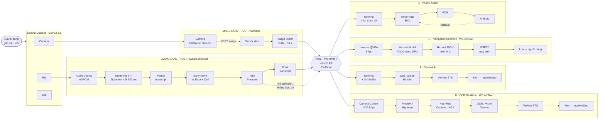
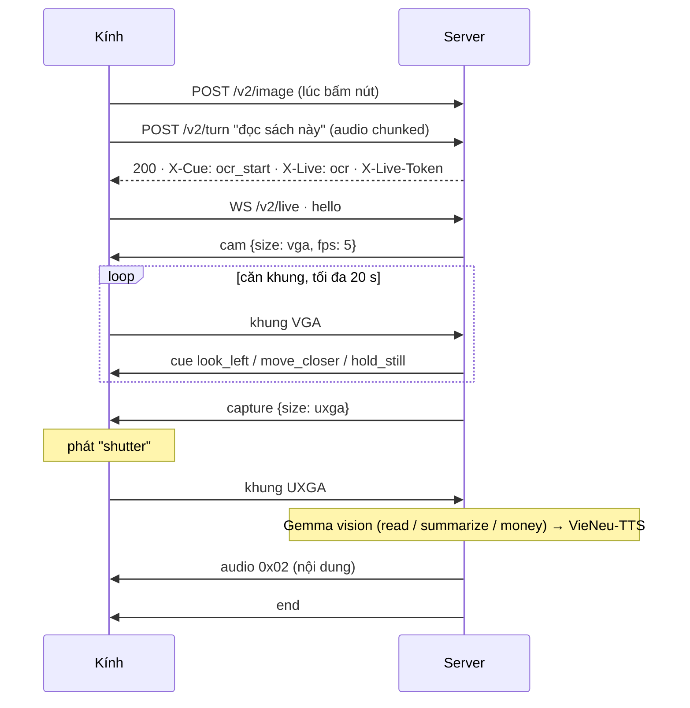
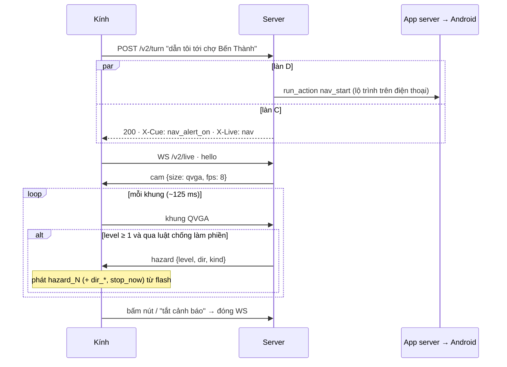

# Kiến trúc voice server SeeVia — Daily Interaction (v2)

Ngày: 2026-10-19. Phạm vi: **voice server** (server kính). App server, FCM, Android
giữ nguyên; tài liệu chỉ mô tả chỗ nối.

Luồng theo sơ đồ "Daily Interaction" người dùng đưa ra: **2 làn vào** (ảnh, âm thanh)
→ **Final Router** → **4 làn xử lý** (A General AI, B OCR Realtime, C Navigation
Realtime, D Phone Action).

Bản này thay bản v1 cùng tên (một endpoint, vòng tự chụp `X-Next`). Những thứ v1 giữ
lại: bảng mã cue, kiểu `Reply`, Gemma thay Gemini, Clef thay SetFit, Google Programmable
Search cho chat, tương thích firmware cũ qua `/process`.

---

## 1. Mục đích và nguyên tắc

Người dùng khiếm thị đeo kính ESP32-S3 + OV2640. Câu lệnh thường: "đọc nội dung sách
này cho tôi", "tóm tắt nội dung này", "trước mặt tôi có gì vậy", "dẫn tôi tới…", gọi
điện, nghe nhạc.

1. **Kính đơn giản, server thông minh.** Kính không hiểu intent; nó chỉ gửi ảnh, gửi
   audio, làm theo lệnh camera, phát âm thanh.
2. **Không chờ tuần tự.** Ảnh gửi ngay lúc bấm nút; audio gửi theo đoạn trong lúc người
   dùng còn nói; server nhận dạng và **làm nóng trước** khi người dùng nói xong.
3. **Prewarm, không thực thi.** Đoán sớm chỉ được chuẩn bị tài nguyên; không gọi điện,
   không gửi lệnh điện thoại, không phát tiếng cho tới khi có bản ghi cuối.
4. **Cố định → mã, thay đổi → audio.** Câu cố định và cảnh báo nguy hiểm phát từ flash
   kính (mã cue / mức cảnh báo); chỉ nội dung động mới qua VieNeu-TTS.
5. **Realtime có trần.** Mọi vòng realtime có giới hạn thời gian và luôn kết thúc bằng
   một câu nói (đọc thử, hoặc báo không làm được).

## 2. Mục tiêu, không làm, phản mục tiêu

**Mục tiêu:** đủ 4 làn A–D; tiếng đầu tiên sau khi nhả nút nhanh hơn hiện tại; cảnh báo
nguy hiểm khi đi đường dưới 0,3 s từ khung hình tới tiếng bíp.

**Không làm:** sửa app server/FCM/Android; dẫn đường từng ngã rẽ (điện thoại lo); lưu ảnh
giấy tờ xuống đĩa.

**Phản mục tiêu:**
- cảnh báo nguy hiểm kêu liên tục đến mức người dùng tắt đi;
- căn khung mãi không bao giờ được đọc;
- đoán sớm sai mà đã thực thi hành động (gọi nhầm người);
- báo "đã xong" khi điện thoại chưa xác nhận.

## 3. Ràng buộc và rủi ro chưa thực nghiệm

| Ràng buộc | Giá trị |
|---|---|
| Camera | OV2640, lens ~120°; UXGA 1600×1200 JPEG đang chạy |
| Audio vào | 16 kHz mono IMA ADPCM, board đã gửi dần trong lúc thu |
| Audio ra | `adpcm_wav` như hiện tại |
| Đường mạng | kính → Cloudflare → server (`app.visioncare-host.uk`); LAN nếu cùng WiFi |
| LLM | Gemma 4 26B-A4B (LAN, UIT dự phòng), tắt thinking |
| Intent | Clef `clef-flash`, timeout 1 s, p50 0,55 s |
| STT | Zipformer-vi 30M int8, 0,032 s/câu trên CPU (đã đo) |
| TTS | VieNeu (vieneu ONNX) |
| GPU server | có (cho model text-detect và hazard) |

**Chưa thực nghiệm, phải thử ở P0 trước khi xây làn B/C:**
- OV2640 đổi framesize lúc chạy (QVGA ↔ UXGA): khung đầu sau khi đổi có hỏng không, mất bao lâu.
- Tốc độ khung thật qua WiFi + TLS: QVGA/VGA bao nhiêu fps.
- WebSocket client trên ESP32-S3 song song với I2S phát tiếng.
- Khoảng cách cầm sách đọc được với lens 120° (ước 20 cm, chưa đo).

---

## 4. Sơ đồ tổng



Mức cảnh báo làn C: `0 Safe` (không gửi) · `1 Danger` · `2 High Danger` · `3 Critical`.

---

## 5. Giao thức kính ↔ server

Ba đường, cùng host. Mọi request mang `X-Device-Id` (MAC kính).

### 5.1. `POST /v2/image` — làn ảnh

Gửi **ngay lúc bấm nút**, trước hoặc song song với audio.

| Phần | Giá trị |
|---|---|
| body | JPEG (UXGA mặc định) |
| header | `X-Device-Id`, `X-Turn-Id` (số ngẫu nhiên mỗi lần bấm nút) |
| response | `204`, không body |

Server giữ ảnh trong **Image Buffer** theo `(device, turn)`, hạn 30 s, chỉ trong RAM.

### 5.2. `POST /v2/turn` — làn âm thanh

Mở ngay khi bấm nút (sau ảnh nếu kính không mở được 2 kết nối cùng lúc), gửi
`Transfer-Encoding: chunked` từng khối ADPCM trong lúc thu; nhả nút thì đóng body.

| Phần | Giá trị |
|---|---|
| body | ADPCM 16 kHz mono, chunked |
| header | `X-Device-Id`, `X-Turn-Id` (trùng với ảnh), `X-Cue-Version`, `Accept` |

Response (luôn 200), giữ header tới khi biết câu đầu tiên:

| Header | Ý nghĩa |
|---|---|
| `X-Cue: a,b` | phát clip a, b trong flash trước audio |
| `X-Live: ocr\|nav` | sau khi phát xong, mở WebSocket realtime (§5.3) |
| `X-Live-Token` | token một lần cho WebSocket, hạn 10 s |
| `X-Audio-*` + body | audio TTS như hiện tại; rỗng nếu chỉ có cue |

### 5.3. `WS /v2/live?token=…` — làn realtime B và C

Mở khi response có `X-Live`. Đóng khi server gửi `end`, khi người dùng bấm nút, hoặc mất
kết nối.

**Kính → server**

| Khung | Nội dung |
|---|---|
| binary | `0x01` + JPEG một khung hình |
| text | `{"t":"hello","device":"…","cue_version":1}` ngay sau khi mở |

**Server → kính**

| Khung | Kính làm gì |
|---|---|
| `{"t":"cam","size":"qvga\|vga\|uxga","fps":8,"quality":12}` | đặt camera, bắt đầu/tiếp tục gửi khung theo fps |
| `{"t":"capture","size":"uxga"}` | chụp 1 khung ở size đó, gửi, rồi dừng gửi khung |
| `{"t":"cue","id":"look_left"}` | phát clip trong flash |
| `{"t":"hazard","level":2,"dir":"left","kind":"motorbike"}` | phát âm cảnh báo theo mức + clip hướng (§11) |
| binary `0x02` + khối ADPCM | phát audio (kết quả OCR) |
| `{"t":"end"}` | đóng WebSocket, về IDLE |

Kính chỉ có **một luật**: làm đúng lệnh vừa nhận. Không có logic căn khung hay đánh giá
nguy hiểm trên kính.

### 5.4. `POST /process` — tương thích firmware cũ

Giữ nguyên hợp đồng hiện tại (multipart ảnh + audio). Bên trong server đổ ảnh vào Image
Buffer, đổ audio vào cùng pipeline §7 (không có partial), làn B/C rơi về chế độ một lần
chụp (đọc luôn ảnh đã có; navigation chỉ gửi lệnh điện thoại). Cue đổi thành TTS khi
không có `X-Cue-Version`.

### 5.5. Máy trạng thái của kính

```
IDLE ──bấm nút──▶ RECORD: chụp UXGA → POST /v2/image
                          mở POST /v2/turn, đẩy audio chunk
     ◀──────────┐   │ nhả nút: đóng body, phát "tíc" + tiếng chờ
                │   ▼
                │  PLAY: phát X-Cue, phát audio
                │   │
                │   ├── không có X-Live ──▶ IDLE
                │   └── có X-Live ──▶ LIVE: mở WS, làm theo lệnh cam/capture/cue/hazard
                │                          │
                └──────── "end" ───────────┘
Bấm nút ở bất kỳ trạng thái nào: đóng mọi kết nối, sang RECORD.
```

---

## 6. Image lane

```
bấm nút ─▶ camera UXGA ─▶ POST /v2/image ─▶ Image Buffer[(device, turn)]
                                               │
                                               ├─ ngay khi vào: decode + resize bản cho LLM (song song)
                                               └─ được dùng bởi: prewarm (§7.4), làn A, làn B (khung đầu)
```

Ảnh tới trước audio nên mọi bước tiền xử lý ảnh nằm ngoài đường chờ.

## 7. Audio lane

### 7.1. Streaming STT (pseudo-streaming)

Zipformer offline giải 0,032 s/câu, nên **giải lại toàn bộ buffer mỗi 300 ms** trong lúc
audio còn đang tới. Không cần model streaming mới.

```
audio chunk ─▶ buffer PCM ─▶ mỗi 300 ms: Zipformer(buffer) ─▶ partial transcript
body đóng   ─▶ Zipformer(buffer đầy đủ) ─▶ final transcript (~0,03 s sau khi nhả nút)
```

ChunkFormer chỉ thay vào nếu chứng minh nghe đúng hơn trên ghi âm thật từ kính
(`request*.wav`); nó không nhanh hơn.

### 7.2. Early Intent Classifier

Chạy trên partial, **chỉ để prewarm**:

1. **Luật từ khoá** (0 ms): "đọc", "tóm tắt" → B; "trước mặt", "có gì" → A; "dẫn đường",
   "đi tới", "cảnh báo" → C; "gọi", "nhạc", "đặt xe" → D.
2. **Clef trên partial** khi partial có ≥ 3 từ và đã ổn định 300 ms; tối đa 2 lượt mỗi
   turn; bỏ nếu còn lượt đang chạy.

### 7.3. Final transcript → final intent

Ngay khi body đóng: Clef trên final transcript (hỏi `intent` + `ocr_mode` như v1). Clef
lỗi/quá 1 s → dùng nhãn early nếu có và khớp luật từ khoá, không thì cue `system_busy`.

### 7.4. Task Prewarm (không thực thi)

| Đoán sớm | Prewarm | Tuyệt đối không |
|---|---|---|
| A General AI | gọi Gemma với ảnh + prompt chung, `max_tokens=1` để nóng prefix cache | sinh câu trả lời |
| B OCR | tạo live session + token; nạp sẵn text detector | mở camera, phát cue |
| C Navigation | tạo live session + token; nóng hazard model | gửi lệnh điện thoại |
| D Phone | nóng prefix Gemma trích tham số; giữ kết nối keep-alive tới :8001 | gửi lệnh điện thoại |

Đoán sai thì bỏ phần đã nóng, không ảnh hưởng gì. Prewarm Gemma chỉ có lợi nếu server
Gemma LAN bật prefix caching cho ảnh (vLLM) — kiểm ở P0; nếu không thì bỏ dòng A.

---

## 8. Final Router

| Intent (Clef) | Làn | Ghi chú |
|---|---|---|
| `chat` | A | Gemma + web_search |
| `space` ("trước mặt có gì") | A | Gemma + ảnh buffer |
| `hazard` (hỏi một lần) | A | Gemma + ảnh buffer |
| `ocr` read / summarize, `money` | B | căn khung realtime rồi chụp high-res |
| `ocr` reread | A | đọc lại `last_text`, không camera |
| `find` | B | dùng cùng cơ chế Camera Control, thay text detector bằng object detector |
| `nav_start` | C + D | D gửi lộ trình cho điện thoại; C bật cảnh báo trên kính |
| `nav_stop` | C + D | đóng live session C, gửi lệnh dừng D |
| `contact_call`, `emergency_call`, `ride_*`, `music_*` | D | |

Bypass hiện có giữ nguyên: đang phát nhạc/chỉ đường mà bấm nút → dừng.

---

## 9. Làn A — General AI

| | |
|---|---|
| **IN** | final transcript, ảnh buffer (nếu intent cần), vị trí đang giữ nóng |
| **OUT** | audio trả lời (response của `/v2/turn`) |

```
final transcript ─▶ Gemma (prefix đã nóng)
                     ├─ cần tin mới ─▶ web_search (Google Programmable Search, ≤ 3 s, top 5) ─▶ Gemma
                     └─ trả lời thẳng
                 ─▶ VieNeu-TTS stream ─▶ kính ─▶ người dùng
```

Câu TTS đầu cắt ngắn (≤ 8 từ) để tiếng ra sớm.

## 10. Làn B — OCR Realtime

| | |
|---|---|
| **IN** | ảnh buffer (khung đầu), khung preview qua WS, `ocr_mode` |
| **OUT** | cue căn khung → âm chụp → audio nội dung qua WS |
| **Trần** | 20 s căn khung; hết trần chụp luôn và đọc thử |

```
/v2/turn trả X-Cue: ocr_start + X-Live: ocr
  │
  ▼ WS mở
Camera Control:   server ─▶ {"t":"cam","size":"vga","fps":5}
Preview/Alignment: khung VGA ─▶ text detector (GPU, PP-OCR det mobile) ─▶ luật căn khung
     ├─ chưa có chữ ................ cue look_around (tối đa 1 lần / 3 s)
     ├─ hộp chữ chạm mép trái/phải/trên/dưới ─▶ cue look_left / look_right / look_up / look_down
     ├─ chiều cao dòng < ngưỡng ..... cue move_closer
     ├─ chữ tràn khung .............. cue move_away
     ├─ mờ (sharpness trong vùng chữ) cue hold_still
     └─ đạt 3 khung liên tiếp ─▶ High-Res Capture
High-Res Capture:  server ─▶ {"t":"capture","size":"uxga"} ; kính phát clip "shutter"
OCR/Vision:        khung UXGA ─▶ Gemma vision (read | summarize | money) ─▶ text stream
VieNeu-TTS:        text ─▶ ADPCM ─▶ WS binary 0x02 ─▶ kính ─▶ người dùng
                   lưu last_text (5 phút) ─▶ {"t":"end"}
```



- Mỗi cue cách nhau ≥ 1,5 s; một vấn đề phải lặp 2 khung mới nói.
- Hướng `look_*` là hướng **quay đầu** (camera gắn trên kính).
- Ngưỡng chiều cao dòng tính trên ảnh UXGA sau khi quy đổi từ VGA; hiệu chuẩn ở P0.
- Không có text detector (P0 chưa xong) → B chạy chế độ một lần: đọc thẳng ảnh buffer.
- `find`: cùng luồng, object detector thay text detector; "đạt" = vật nằm giữa khung →
  audio vị trí + khoảng cách, không cần chụp high-res.

## 11. Làn C — Navigation Realtime

| | |
|---|---|
| **IN** | khung QVGA ~8 fps qua WS |
| **OUT** | `hazard` JSON → kính tự phát cảnh báo trong flash |
| **Bật/tắt** | `nav_start` hoặc "bật cảnh báo"; `nav_stop`, "tắt cảnh báo", hoặc bấm nút |

```
X-Live: nav ─▶ WS ─▶ {"t":"cam","size":"qvga","fps":8,"quality":15}
khung QVGA ─▶ Hazard Model (detector GPU, YOLO nano) ─▶ luật mức nguy hiểm
           ─▶ Hazard JSON {"t":"hazard","level":0..3,"dir":"left|center|right","kind":"…"}
           ─▶ ESP32 local alert ─▶ loa
```



**Mức nguy hiểm** (theo hình):

| level | Nghĩa | Kính phát |
|---|---|---|
| 0 Safe | không có gì trên đường đi | im lặng (server **không gửi**) |
| 1 Danger | vật cản ở xa hoặc lệch đường đi | 1 bíp nhẹ |
| 2 High Danger | vật cản gần, ở giữa | bíp nhanh + clip hướng ("bên trái") |
| 3 Critical | xe đang lao tới / rất gần | âm liên tục + clip "dừng lại" |

**Luật mức (bản đầu, chỉnh ở P3):** lớp vật (xe > người > cột/vật tĩnh), diện tích hộp
(thay cho khoảng cách), vị trí so với giữa khung, hộp lớn dần qua các khung (đang tới gần).

**Chống làm phiền:**
- chỉ gửi khi mức **tăng**, hoặc nhắc lại mỗi 2 s khi mức ≥ 2;
- mức phải giữ 2 khung liên tiếp mới gửi (trừ level 3: gửi ngay);
- level 1 tối đa 1 lần / 5 s.

**Độ trễ mục tiêu:** khung → bíp ≤ 300 ms (upload QVGA ~10 KB, model ~10 ms, đẩy WS).

Dẫn đường từng ngã rẽ do điện thoại nói (làn D mở lộ trình). Làn C chỉ lo vật cản.

## 12. Làn D — Phone Action

Giữ nguyên `run_action()`, app server, callback (`KIEN_TRUC_SERVER.md`, `PLAN.md`).

```
final transcript ─▶ cần tham số? ─▶ Gemma generate_json ─▶ thiếu ─▶ cue ask_<slot> (lưu pending_slot)
               ─▶ run_action ─▶ Server App :8001 ─▶ FCM ─▶ Android ─▶ callback
               ─▶ xong (câu cố định): cue · có dữ liệu: audio · quá ngân sách: cue phone_pending
```

`emergency_call` trả cue `emergency_started` ngay, không chờ callback.

---

## 13. Âm thanh trong flash kính

Bảng cue v1 giữ nguyên (`pipeline/cues.py`, `CUE_VERSION`), thêm:

| id | Dùng ở | Âm |
|---|---|---|
| `ocr_start` | B bắt đầu | "Đưa sách ra trước mặt." |
| `hold_still` | B | "Giữ yên." |
| `shutter` | B chụp high-res | tiếng chụp |
| `hazard_1` / `hazard_2` / `hazard_3` | C | bíp nhẹ / bíp nhanh / âm liên tục |
| `dir_left` / `dir_center` / `dir_right` | C level ≥ 2 | "Bên trái." / "Phía trước." / "Bên phải." |
| `stop_now` | C level 3 | "Dừng lại." |
| `nav_alert_on` / `nav_alert_off` | C bật/tắt | "Đã bật cảnh báo." / "Đã tắt cảnh báo." |

---

## 14. Ngân sách độ trễ (mục tiêu, chưa đo)

| Chặng | Trước | Sau |
|---|---|---|
| Upload ảnh | sau khi nhả nút (0,3–1,5 s) | lúc bấm nút, nằm ngoài đường chờ |
| Upload audio | sau khi nhả nút | đã gửi xong lúc nhả nút |
| STT | 0,03 s | 0,03 s (final) |
| Intent | SetFit + Gemini trích tham số | Clef 0,55 s, song song với prewarm |
| LLM token đầu (có ảnh) | chưa đo | nhanh hơn nếu prefix cache ăn |
| TTS câu đầu | chưa đo | câu đầu ≤ 8 từ |
| **Nhả nút → tiếng đầu, làn A** | chưa đo | **mục tiêu ≤ 2 s** |
| Khung → bíp nguy hiểm, làn C | không có | **≤ 0,3 s** |

Đo bằng log 4 mốc trên kính (bấm, nhả, byte đầu, tiếng đầu) và log từng chặng trên
server, gọi qua `https://app.visioncare-host.uk/` như kính thật.

## 15. Mô-đun

| Mô-đun | Việc |
|---|---|
| `app.py` | thêm `/v2/image`, `/v2/turn` (đọc body theo stream), `/v2/live` (WebSocket); giữ `/process` |
| `pipeline/image_buffer.py` | **thêm**: buffer RAM theo `(device, turn)`, hạn 30 s, resize sẵn |
| `pipeline/stt_stream.py` | **thêm**: pseudo-streaming trên `pipeline/stt.py` |
| `pipeline/intent_early.py` | **thêm**: luật từ khoá + Clef trên partial |
| `pipeline/prewarm.py` | **thêm**: bảng §7.4, huỷ được |
| `pipeline/intent.py` | **thay**: Clef final + Gemma trích tham số |
| `pipeline/router.py` | **sửa**: Final Router → 4 làn |
| `lanes/general.py`, `lanes/ocr_live.py`, `lanes/nav_live.py`, `lanes/phone.py` | **thêm** (gom từ `handlers/*`) |
| `live/session.py`, `live/protocol.py` | **thêm**: phiên WebSocket, khung lệnh §5.3 |
| `live/text_align.py` | **thêm**: text detector + luật căn khung |
| `live/hazard.py` | **thêm**: detector + luật mức + chống làm phiền |
| `models/llm/client.py`, `models/clef/client.py`, `models/search/client.py` | **thêm** (Gemma, Clef, Google Search) |
| `models/vlm/client.py` (Gemini), `pipeline/intent_local.py` (SetFit), `handlers/waiting.py` | **bỏ** |
| `pipeline/stt.py`, `tts.py`, `adpcm.py`, `phrases.py`, `image_quality.py` | giữ |
| `pipeline/cues.py`, `pipeline/reply.py` | **thêm** (như v1) + mã §13 |
| `tools/make_cue_clips.py` | **thêm**: sinh clip flash từ bảng cue |
| `tools/bench_live.py` | **thêm**: giả lập kính gửi ảnh/audio/khung WS tới host thật, in từng mốc |

## 16. Thứ tự triển khai

1. **P0 — đo và thử phần cứng:** đo `/process` hiện tại qua `app.visioncare-host.uk`;
   thử OV2640 đổi framesize, fps QVGA/VGA thật, WebSocket trên ESP32-S3; khoảng cách
   đọc sách; server Gemma có prefix cache cho ảnh không.
2. **P1 — làn vào + A + D:** `/v2/image`, `/v2/turn` chunked, pseudo-streaming STT,
   early intent + prewarm, Clef, Gemma, cue. `/process` vẫn chạy cho kính cũ.
3. **P2 — làn B:** WebSocket, Camera Control, text detector, căn khung, high-res capture.
4. **P3 — làn C:** hazard model, luật mức, chống làm phiền, thử ngoài đường.
5. **P4 — firmware đầy đủ + tinh chỉnh ngưỡng** từ log thật.

## 17. Còn mở / để lại cho builder

- Chọn checkpoint text detector (PP-OCR det mobile hay tương đương) và hazard detector
  (YOLO nano COCO trước; bậc thang, ổ gà, cột cần dữ liệu riêng — để sau).
- Kính mở được 2 kết nối TLS cùng lúc không (RAM): nếu không, gửi ảnh trước rồi mới mở
  `/v2/turn`, audio đệm trong PSRAM trong lúc chờ.
- Cloudflare tunnel có giữ WebSocket ổn định không; timeout idle.
- Huỷ Gemma/TTS khi kính ngắt kết nối.

## 18. Lựa chọn do Claude quyết (người dùng kiểm khi đọc)

- Giữ **Gemma** dù hình ghi Gemini (theo quyết định trước đó của người dùng).
- **WebSocket** cho làn B/C; HTTP cho làn ảnh, làn âm thanh, A và D.
- **Pseudo-streaming** STT bằng Zipformer hiện có (giải lại buffer mỗi 300 ms).
- Early intent = luật từ khoá + Clef trên partial, tối đa 2 lượt/turn.
- `find` đi làn B với object detector; `space` và hỏi nguy hiểm một lần đi làn A;
  `nav_start` bật cả C và D.
- Level 0 không gửi gì; luật chống làm phiền ở §11.
- Trần 20 s cho căn khung OCR; hết trần chụp luôn và đọc thử.
